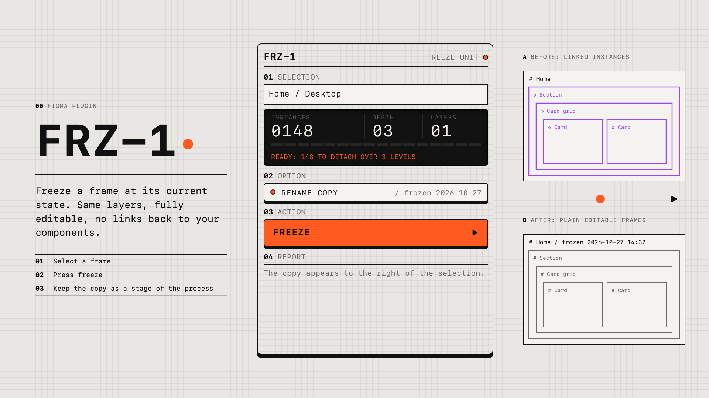
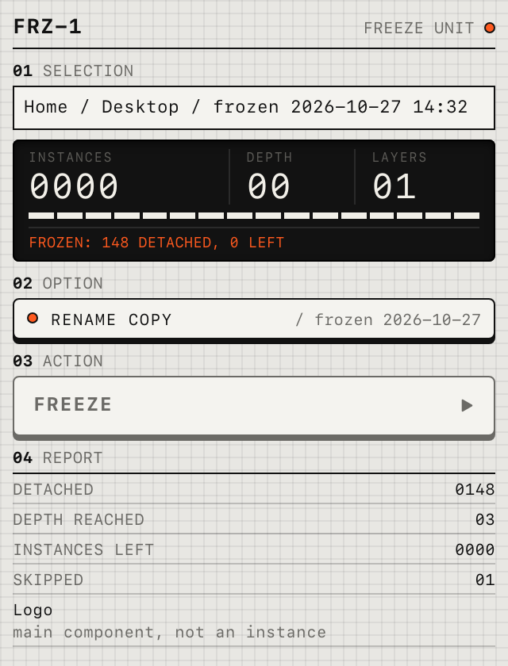

# FRZ-1

A Figma plugin that freezes a frame. It makes a copy of the selected frame and detaches every component instance inside the copy, including nested ones. You keep an editable snapshot of the design as it looks today, with no links back to the components you are still changing.



## About

When you iterate on components, every change spreads to every design that uses them. Most of the time that is exactly what you want. It also means older stages of a design disappear: the frame you showed last week now looks like this week.

FRZ-1 records those stages. Select a frame, press **Freeze**, and the plugin places a frozen copy next to it. The copy has the same layers and looks identical, but every instance in it is now a plain frame. Collect the frozen copies on a page of their own and you get a record of the whole design process.

The plugin runs entirely inside Figma. It has no network access, no analytics and no runtime dependencies.

## Install locally

You need [Node.js](https://nodejs.org/) 18 or newer and the Figma desktop app.

```sh
git clone https://github.com/Smilesharks/frz-1.git
cd frz-1
npm install
npm run build
```

Then in Figma desktop:

1. Open any design file.
2. Go to **Plugins > Development > Import plugin from manifest...**
3. Pick `manifest.json` in the `frz-1` folder.

The plugin now appears under **Plugins > Development > FRZ-1**. Run `npm run build` again after changing the code; Figma picks up the new `dist/code.js` the next time you open the plugin.

## Use it

1. Select one or more frames, or an instance. The window shows the selection name and how many instances it contains, counting nested ones, plus how deep the nesting goes.
2. Leave **Rename copy** on to add `/ frozen YYYY-MM-DD HH:MM` to the copy's name, or press it to keep the original name.
3. Press **Freeze**. The plugin duplicates the selection, places the copy to the right of it without overlapping other layers, and detaches every instance in the copy.
4. The report shows how many instances were detached, the nesting depth reached, how many instances are left (should be zero) and any layers that were skipped, with the reason.
5. Move the frozen copy wherever you keep your process frames.

The original is never changed. One **Undo** (Cmd+Z) removes the whole freeze.



## How nested instances are handled

Detaching an instance turns it into a frame, but instances nested inside it stay linked to their own components. Figma also cannot detach an instance that sits inside another instance without detaching its parents first.

So the plugin works from the outside in, one level per round:

1. Find every instance in the copy with `findAllWithCriteria({ types: ['INSTANCE'] })`.
2. Keep only the outermost ones, those with no instance above them.
3. Detach those, in batches of 50, pausing between batches so Figma stays responsive and the progress bar can update.
4. Search again and repeat until no instances are left.

The number of rounds is the nesting depth shown in the report. Hidden instances are detached too, because a hidden instance is still a link to a component.

## Limitations

- **Main components are skipped.** Selecting a main component would create a new component, not a snapshot, so the plugin skips it and says so in the report. A main component *inside* a selected frame is turned into a plain frame in the copy, so the snapshot adds nothing to your assets.
- **Component sets inside a frame stay as component sets.** Turning variants into frames would break the set, so the copy keeps a new component set and the report lists it.
- **Variables and styles stay linked.** Detaching removes the link to components only. Colours, text styles and variables used in the copy still point to your library, so changing a style or variable will change the frozen copy as well.
- **Very large frames** take a while. The plugin works in batches so Figma does not freeze, but thousands of instances still take seconds rather than milliseconds.

## Replace the screenshot

The images in `docs/` are rendered from `ui.html` with mock data by `npm run render` (it uses Playwright, installed as a development dependency only). To use a real screenshot instead:

1. Run the plugin in Figma desktop on a real frame.
2. Take a screenshot of the plugin window, for example with Cmd+Shift+4 then Space on macOS.
3. Save it as `docs/ui-result.png`, replacing the rendered one. For the cover, save a 1920 x 1080 image as `docs/cover.png`.

Running `npm run render` again will overwrite your screenshots, so only run it if you want the mock versions back.

## Project layout

```text
manifest.json      Figma plugin manifest (no network access, dynamic page loading)
src/code.ts        Plugin entry: talks to the UI and runs a freeze
src/freeze.ts      Duplicating, placing and detaching
ui.html            Plugin window: plain HTML, CSS and JavaScript
assets/            Icon as SVG and 128 x 128 PNG
docs/              README images
scripts/           Renders the icon PNG and README images
```

## Licence

[MIT](LICENSE)
